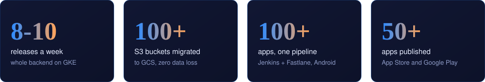
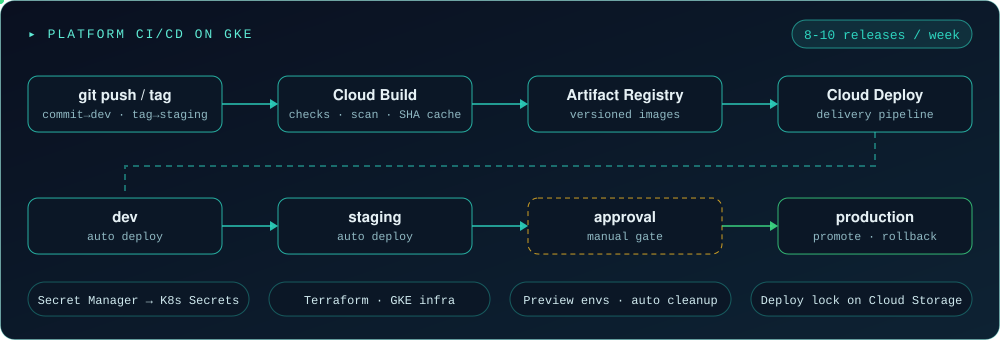
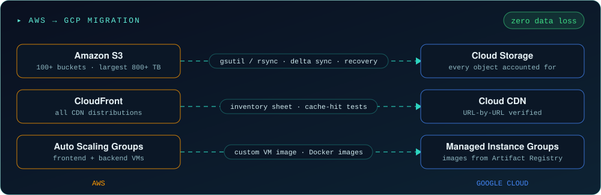
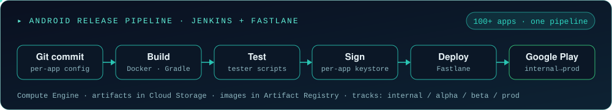

## What I've built

<b>How the GKE platform works</b>

- Separate GCP projects for dev, staging, production and infra; the environment is chosen from the Git commit or tag; production only by Cloud Deploy promotion behind a manual approval.
- Cloud Build and Cloud Deploy pipelines with per-environment manifests; GKE infrastructure in Terraform.
- Secrets in Secret Manager, validated before every build and synced to Kubernetes; production secrets pre-synced during staging builds so promotions never ship stale values.
- Distributed deploy lock on Cloud Storage so concurrent deployments never collide.
- Images cached by commit SHA, cutting dev builds from minutes to seconds; dependency scanning and style checks as quality gates.
- Preview environments with automatic cleanup; Workload Identity, least-privilege IAM, HPA, liveness and readiness probes.

<b>How the migration was done</b>

- Copied S3 to Cloud Storage with gsutil and rsync, kept the transfer logs, scripted recovery of every object that failed to copy, and ran daily delta syncs until cutover.
- Replaced each CloudFront distribution with Cloud CDN, tracked old to new URLs in an inventory sheet and tested every URL for cache hits.
- Replaced Auto Scaling Groups with Managed Instance Groups from a custom VM image, running Docker images from Artifact Registry.

<b>More: iOS releases, AWS analytics and cost tracking</b>

- **iOS release operations:** Apple Developer setup, certificates, provisioning profiles and push keys per app; Azure DevOps pipeline to TestFlight; App Review rejections handled through to approval; wrote the team's iOS launch runbook.
- **Platform analytics:** daily and monthly usage dashboard (Athena, Glue, QuickSight) for signups and daily active users.
- **Cost visibility:** daily AWS cost report email, then per-workload cost tracking with resource tags and a QuickSight dashboard.
- **Monitoring:** alerts and live dashboards on AWS and GCP that show what failed and exactly where.

## Tech stack

## Experience

| Role | Company | Period |
|---|---|---|
| DevOps Engineer | Learnyst | Jan 2025 - Aug 2026 |
| Mobile DevOps Engineer | Learnyst | Jul 2023 - Dec 2024 |

**Also:** mentored two junior engineers on app build and release, with knowledge-transfer sessions and step-by-step docs; the team's go-to for deployment and release issues.

**Education:** B.E. in Computer and Information Sciences, RNS Institute of Technology (2019 - 2023)

## Connect

[LinkedIn](https://www.linkedin.com/in/gokul-krishna-v-b5b237234/) · Open to DevOps, Platform, SRE and Cloud roles · Available immediately
