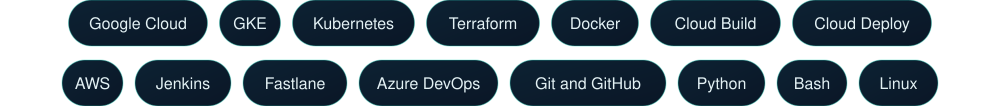

3+ years of DevOps at an EdTech SaaS company: Kubernetes (GKE) delivery pipelines on Google Cloud, Terraform, a large AWS to GCP migration, and release automation for 100+ mobile apps. Open to DevOps, Platform, SRE and Cloud roles. Available to join immediately.

Also: built alerts and live dashboards on AWS and GCP that show what failed and exactly where; moved every CDN from CloudFront to Cloud CDN; maintained 100+ live apps on the App Store and Google Play, including force-update rollouts.

## Selected work

### Platform CI/CD on GKE (Google Cloud)
Built end to end, working with the CTO on tooling choices.
- Separate GCP projects for dev, staging, production and infra; environment chosen from the Git commit or tag; production only by Cloud Deploy promotion with manual approval.
- Cloud Build and Cloud Deploy pipelines with per-environment manifests; GKE infrastructure managed in Terraform.
- Secrets in Secret Manager, validated before every build and synced to Kubernetes; production secrets pre-synced during staging builds so promotions never ship stale values.
- Distributed deploy lock on Cloud Storage to stop concurrent deployments from colliding.
- Image caching by commit SHA, which cut dev builds from minutes to seconds; dependency scanning and style checks as quality gates.
- Preview environments with automatic cleanup; Workload Identity, least-privilege IAM, HPA, and liveness and readiness probes.

### AWS to GCP migration
- Moved S3 data to Cloud Storage with gsutil and rsync; kept transfer logs, scripted recovery of every object that failed to copy, and ran daily delta syncs until cutover.
- Replaced each CloudFront distribution with Cloud CDN, tracked in an inventory sheet and tested for cache hits.
- Replaced AWS Auto Scaling Groups with GCP Managed Instance Groups running Docker images from Artifact Registry.

### Android CI/CD (Jenkins + Fastlane)
- Replaced manual builds with a 6-stage Jenkins pipeline from Git commit to Google Play (internal, alpha, beta and production tracks).
- One pipeline for many apps, with isolated config, signing keystore and versioning for each.
- Dockerised build environment on Compute Engine, with artifacts in Cloud Storage and images in Artifact Registry.

### iOS release operations
- Apple Developer setup, certificates, provisioning profiles and push keys for each app; App Store Connect configuration.
- Azure DevOps pipeline that pushed builds to TestFlight; handled App Review rejections through to approval.
- Wrote the team's step-by-step runbook for launching a new iOS app.

### AWS analytics and cost visibility
- Daily and monthly platform usage dashboard (Athena, Glue, QuickSight) for admin and learner signups and daily active users.
- Daily AWS cost report email, then per-workload cost tracking through resource tags and a QuickSight cost dashboard.

## Tools

**Google Cloud:** GKE, Cloud Build, Cloud Deploy, Compute Engine (VMs, custom images, Managed Instance Groups), Cloud Storage, Cloud CDN, Artifact Registry, Secret Manager, IAM, Workload Identity

**AWS:** S3, Lambda, CloudWatch, CloudFront, Route 53, Athena, Glue, QuickSight, cost reports and tagging

**CI/CD:** Jenkins, Fastlane, Gradle, Azure DevOps, Git, GitHub

**Infrastructure and runtime:** Terraform, Docker, Kubernetes, Linux

**Scripting:** Bash, Python

**Mobile release:** App Store Connect, TestFlight, Google Play Console, code signing, Firebase (Cloud Messaging, Google Sign-In)

## Achievements

- Mentored two junior team members on building and releasing mobile apps, with written step-by-step documentation and knowledge-transfer sessions on the whole build process.
- Taught developer account setup for iOS and Android, keystore generation and signing.
- The team's point of contact for app deployment and release problems.

## Experience

- **DevOps Engineer**, Learnyst (Jan 2025 - Aug 2026)
- **Mobile DevOps Engineer**, Learnyst (Jul 2023 - Dec 2024)

## Education

B.E. in Computer and Information Sciences, RNS Institute of Technology (2019 - 2023)

## Currently learning

Python scripting for DevOps, and deeper Kubernetes and observability practice.

## Find me

[LinkedIn](https://www.linkedin.com/in/gokul-krishna-v-b5b237234/)
